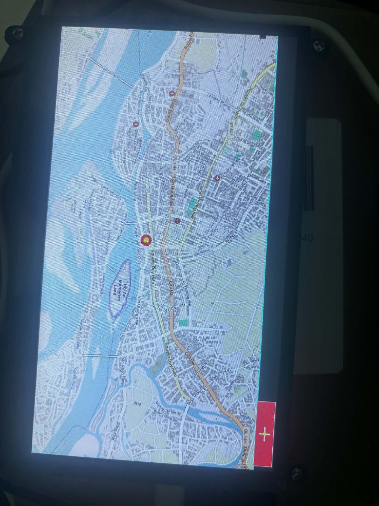
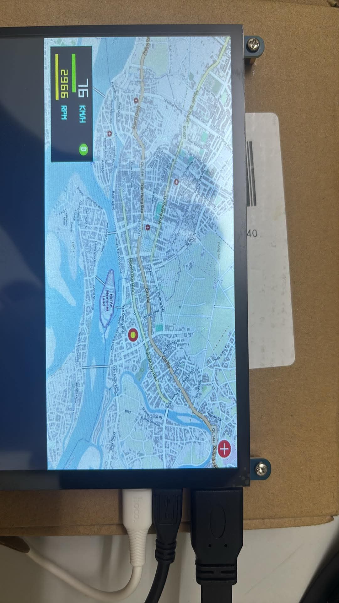

# In-Vehicle Infotainment & Telematics Gateway System

Dự án phát triển hệ thống Gateway và bảng đồng hồ hiển thị thông tin buồng lái xe hơi (Cluster / Infotainment) trên nền tảng **BeagleBone Black** (chip TI AM3358, nhân Linux Kernel 6.6.58 build từ Buildroot) và vi điều khiển **ESP32-C3**.

Hệ thống được thiết kế theo kiến trúc chuẩn Automotive: phân tách rõ ràng giữa phần cứng, tầng Kernel Driver thời gian thực và giao diện người dùng Native C, giao tiếp với các nút cảm biến qua mạng CAN Bus / UART.

---

## Kiến trúc Tổng thể Hệ thống

```text
[ CẢM BIẾN / CHÂN GA TPS ]
           │
           ▼
[ ESP32-C3 (Sensor / Engine ECU) ]
           │
           ├── [ CAN Bus (125 kbps) / UART ] ── (Module TI SN65HVD230)
           │
           ▼
[ BEAGLEBONE BLACK (Central Gateway & Cluster Unit) ]
   ├── Linux Kernel 6.6.58 (Custom Buildroot)
   ├── Platform Driver & Device Tree Overlay (speed_platform_driver)
   ├── Character Device & IOCTL Interface (/dev/mydev, /dev/speed_dev)
   ├── Native Framebuffer Engine (/dev/fb0 - RGB565 mmap)
   └── Multi-touch Event Processing (/dev/input/event1 - hid-multitouch)
           │
           ▼
[ MÀN HÌNH LCD 7-INCH & CẢM ỨNG ĐA ĐIỂM (Micro-HDMI / USB CTP) ]
```

---

## Cấu trúc Mã nguồn

```text
~/car-ivi/                       # Không gian làm việc trên Ubuntu VM
├── chardev_control/             # Module Character Device & Giao thức IOCTL
│   ├── hello.c                  # Driver đăng ký cdev, VFS read/write/ioctl
│   ├── test_ioctl.c             # Ứng dụng User Space cấu hình thiết bị qua IOCTL
│   └── Makefile                 # File build cross-compile ARM
│
├── wheel_speed_sensor/          # Module Đo Tốc độ Xe bằng Ngắt Phần cứng
│   ├── speed_driver.c           # Driver ngắt sườn âm GPIO 540, debounce ktime, poll
│   ├── test_speed.c             # Ứng dụng đọc tốc độ thời gian thực (0% CPU)
│   └── Makefile
│
├── platform_driver/             # Module Platform Driver & Device Tree Chuẩn Công nghiệp
│   ├── speed_sensor.dts         # Bản vẽ phần cứng Device Tree (Bank 1, pin 28)
│   ├── speed_platform_driver.c  # Driver sử dụng hàm probe/remove chuẩn Linux mainline
│   └── Makefile
│
├── touch_gui/                   # Engine Đồ họa Framebuffer & Cảm ứng Đa điểm cơ bản
│   ├── touch_gui.c              # Render trực tiếp lên /dev/fb0 và đọc /dev/input/event1
│   └── Makefile
│
├── map_navi_gui/                # Engine Bản đồ Định vị GPS & HUD Tốc độ LED 7 Đoạn
│   ├── get_map.py               # Script tải bản đồ OpenStreetMap & xuất raw RGB565 (1024x600)
│   ├── map_navi.c               # Ứng dụng C Framebuffer, SocketCAN, 7-Segment HUD & Touch
│   └── Makefile                 # File build cross-compile ARM
│
├── can_gateway/                 # Gateway Trung tâm SocketCAN & Dashboard Buồng lái (BeagleBone Black)
│   ├── can_receiver.c           # Ứng dụng C SocketCAN Non-blocking & Digital Cockpit
│   ├── dcan1.dts                # Device Tree Overlay kích hoạt DCAN1 (P9_24, P9_26)
│   └── Makefile                 # File build cross-compile ARM
│
├── can_sender/                  # Firmware ECU Động cơ & Cảm biến Chân ga TPS (ESP32-C3)
│   ├── main/
│   │   ├── throttle_sensor.h    # Module đọc cảm biến bàn đạp ga ADC GPIO 2
│   │   ├── throttle_sensor.c
│   │   ├── main.c               # Điều phối phát CAN 125 kbps qua TWAI driver
│   │   └── CMakeLists.txt
│   └── CMakeLists.txt
│
├── car-ivi/                     # Giao diện Buồng lái Web HMI & Bản đồ Định vị 3D
│   ├── map-module/              # Ứng dụng Leaflet GPS Map & Three.js 3D Car Rendering
│   └── server.js                # WebSocket & Telematics Gateway Server
│
├── bientro/                     # Baseline Firmware đọc ADC chân ga ESP-IDF
├── ketqualan1.jpg               # Ảnh chụp kết quả bản đồ số Framebuffer trên LCD 7-inch
├── ketqualan2.jpg               # Ảnh chụp thực tế tích hợp cụm đồng hồ tốc độ CAN Bus trên LCD 7-inch
├── .gitignore
└── README.md
```

---

## Thiết lập Môi trường Biên dịch (Build Environment)

* **Toolchain Cross-Compile (Ubuntu VM):**
  * Compiler: `arm-linux-gcc` (`arm-buildroot-linux-gnueabihf-`)
  * Kernel Source Tree: `/home/thuan131004/bbb_workspace/buildroot/output/build/linux-6.6.58`
  * Device Tree Compiler: `dtc` và `fdtoverlay`
* **Giao thức triển khai:**
  * Truyền nhận file sang board qua giao thức mạng USB Gadget Ethernet (`192.168.7.2`):
    ```bash
    scp -O <file> root@192.168.7.2:/root/
    ```
  * Debug qua cổng nối tiếp UART Serial (CH340 - 115200 baud, 8N1).

---

## 1. Module Giao diện Thiết bị Ký tự & IOCTL (`chardev_control`)

Module cung cấp kênh giao tiếp cơ bản giữa không gian người dùng và Kernel Space, hỗ trợ đọc/ghi chuỗi byte và cấu hình thanh ghi thiết bị thông qua các mã lệnh IOCTL chuẩn POSIX.

### Chi tiết Kỹ thuật
* Đăng ký dynamic major/minor number qua `alloc_chrdev_region`, tạo node `/dev/mydev` tự động qua `class_create` và `device_create`.
* Thực hiện sao chép an toàn vùng nhớ bằng `copy_to_user` và `copy_from_user`.
* Định nghĩa tập lệnh IOCTL:
  * `MYDEV_SET_VAL`: Ghi giá trị tham số vào Kernel buffer.
  * `MYDEV_GET_VAL`: Đọc giá trị tham số từ Kernel buffer về ứng dụng.

### Biên dịch & Kiểm thử
**Biên dịch trên host:**
```bash
cd ~/car-ivi/chardev_control
make
make deploy
```

**Thực thi trên BeagleBone Black:**
```bash
cd /root
insmod hello.ko
./test_ioctl
```

**Kết quả kiểm tra:**
```text
# insmod hello.ko
[  880.192124] mydev: Khoi tao kem IOCTL thanh cong! Major = 238, Minor = 0

# ./test_ioctl
[USER] Gửi lệnh IOCTL SET gia tri = 2026 vao Kernel...
[  890.715091] mydev: [IOCTL] Da dat gia tri moi = 2026
[USER] Gửi lệnh IOCTL GET gia tri tu Kernel ve...
[  890.725648] mydev: [IOCTL] Da doc gia tri = 2026
[USER] Ket qua nhan duoc: 2026
🎉 TEST IOCTL THANH CONG 100%!
```

---

## 2. Module Thu thập Vận tốc Xe qua Ngắt Phần cứng (`wheel_speed_sensor`)

Module đóng vai trò là tầng tiếp nhận tín hiệu từ cảm biến xung bánh xe (Wheel Speed Sensor / Hall Sensor) với khả năng phản hồi thời gian thực tức thời mà không làm tiêu tốn tài nguyên xử lý của CPU.

### Chi tiết Kỹ thuật
* **Phần cứng:** Chân `P9_12` (GPIO 540 trên Kernel 6.6) được kích hoạt điện trở kéo lên nội 3.3V. Mỗi xung quay của bánh xe tương ứng với một lần chạm mass `P9_01` (GND), tạo sườn âm (Falling Edge).
* **Lọc nhiễu tiếp điểm (Debouncing):** Dùng đồng hồ nano-giây `ktime_get()`. Triệt tiêu mọi xung nhiễu nảy kim loại có chu kỳ $< 100\text{ms}$.
* **Đồng bộ hóa đa luồng:** Dùng kiểu dữ liệu nguyên tử `atomic_t` cho biến đếm xung (`pulse_count`), ngăn chặn hiện tượng Race Condition giữa ngữ cảnh ngắt (ISR) và tiến trình đọc.
* **Cơ chế Event-Driven (WaitQueue & Poll):** Ứng dụng User Space gọi `poll()` sẽ rơi vào trạng thái ngủ sâu (**0% CPU**). Khi xuất hiện ngắt, Kernel đánh thức ứng dụng qua `wake_up_interruptible(&speed_waitqueue)` để đọc và tính toán vận tốc.

### Sơ đồ Đấu nối Chân (Header P9)
```text
Header P9 (BeagleBone Black)
Row 1:  [ P9_01 ] (GND)    [ P9_02 ] (GND)
Row 6:  [ P9_11 ]          [ P9_12 ] (GPIO 540 - Pulse Input)
```

### Biên dịch & Kiểm thử
**Biên dịch trên host:**
```bash
cd ~/car-ivi/wheel_speed_sensor
make
make deploy
```

**Thực thi trên BeagleBone Black:**
```bash
cd /root
rmmod speed_driver 2>/dev/null
insmod speed_driver.ko
chmod +x test_speed
./test_speed
```

**Kết quả kiểm tra:**
```text
=========================================
   CAR-IVI WHEEL SPEEDOMETER TEST
=========================================
[USER SPACE] Dang o che do NGU YEN cho banh xe quay (0% CPU)...

[ 2718.266557] speed_driver: [NGAT HOP LE] Da nhan 1 xung! Tong so xung = 1
🚗 [BANH XE QUAY] Xung thu:   1 | Toc do mo phong:   1.5 km/h
[ 2719.366600] speed_driver: [NGAT HOP LE] Da nhan 1 xung! Tong so xung = 2
🚗 [BANH XE QUAY] Xung thu:   2 | Toc do mo phong:   3.0 km/h
[ 2720.656728] speed_driver: [NGAT HOP LE] Da nhan 1 xung! Tong so xung = 3
🚗 [BANH XE QUAY] Xung thu:   3 | Toc do mo phong:   4.5 km/h
```

---

## 3. Module Tích hợp Device Tree & Platform Driver (`platform_driver`)

Chuyển đổi toàn bộ driver sang kiến trúc **Platform Driver** chuẩn Linux mainline nhằm loại bỏ việc gán cứng chân phần cứng trong mã nguồn C, cho phép driver tái sử dụng linh hoạt trên nhiều biến thể phần cứng khác nhau.

### Chi tiết Kỹ thuật
* **Device Tree Overlay (`speed_sensor.dts`):** Mô tả thiết bị độc lập với chuỗi định danh `compatible = "car-ivi,speed-sensor";` và chân phần cứng `speed-gpios = <&gpio1 28 1>;` (Bank 1, pin 28, Active-Low).
* **Ghép nối DTB gốc:** Sử dụng công cụ `fdtoverlay` hợp nhất file `.dtbo` trực tiếp vào bản vẽ phần cứng `am335x-boneblack.dtb` của hệ thống.
* **Platform Driver Binding:** Driver đăng ký bảng `of_device_id`. Khi Kernel nạp Device Tree và phát hiện nút thiết bị tương ứng, hàm **`probe()`** tự động được kích hoạt để bóc tách tài nguyên qua `gpiod_get(dev, "speed", ...)` và ánh xạ số hiệu ngắt qua `gpiod_to_irq()`.

### Cấu hình Device Tree
```dts
/dts-v1/;
/plugin/;

/ {
    fragment@0 {
        target-path = "/";
        __overlay__ {
            car_speed_sensor {
                compatible = "car-ivi,speed-sensor";
                speed-gpios = <&gpio1 28 1>;
                status = "okay";
            };
        };
    };
};
```

### Quy trình Tích hợp & Kiểm thử
**1. Biên dịch và ghép DTB trên host:**
```bash
cd ~/car-ivi/platform_driver
make

# Ghép node vào DTB gốc
cp ~/bbb_workspace/buildroot/output/images/am335x-boneblack.dtb .
~/bbb_workspace/buildroot/output/host/bin/fdtoverlay -i am335x-boneblack.dtb -o am335x-boneblack.dtb speed_sensor.dtbo
```

**2. Cập nhật phân vùng Boot trên BeagleBone Black:**
```bash
# Trên board: Mount phân vùng boot
mkdir -p /mnt/boot && mount /dev/mmcblk0p1 /mnt/boot

# Trên host: Copy file DTB mới sang board
scp -O am335x-boneblack.dtb root@192.168.7.2:/mnt/boot/

# Trên board: Sync và khởi động lại
sync && umount /mnt/boot && reboot
```

**3. Xác thực liên kết Platform Driver:**
```bash
# Kiểm tra node thiết bị trong Device Tree
ls -d /sys/firmware/devicetree/base/car_speed_sensor

# Nạp module driver
insmod speed_platform_driver.ko
dmesg | tail -n 5
```

**Kết quả xác thực:**
```text
[   52.143670] speed_platform_driver: loading out-of-tree module taints kernel.
[   52.151995] car_speed_sensor car_speed_sensor: speed_platform: Bat tay phan cung thanh cong! Bat dau khoi tao...
[   52.165239] car_speed_sensor car_speed_sensor: Kernel tu cap phat IRQ so: 63 cho cam bien toc do
[   52.174845] car_speed_sensor car_speed_sensor: Platform Driver da san sang bat xung!
```

---

## 4. Module Đồ Họa Framebuffer & Xử lý Cảm Ứng Đa Điểm (`touch_gui`)

Engine dựng hình đồ họa Native C trực tiếp trên bộ nhớ đệm màn hình (Framebuffer) kết hợp giải mã luồng sự kiện cảm ứng đa điểm phục vụ giao diện buồng lái xe hơi.

### Chi tiết Kỹ thuật
* **Điều khiển Framebuffer `/dev/fb0`:**
  * Ánh xạ trực tiếp video RAM của chip phát HDMI NXP TDA19988 vào không gian địa chỉ tiến trình bằng `mmap()`.
  * Định dạng điểm ảnh **RGB565** (`uint16_t` / pixel), tối ưu tốc độ ghi dữ liệu.
  * Xây dựng bộ hàm nguyên thủy: vẽ điểm ảnh (`draw_pixel`), vẽ hình chữ nhật (`draw_rect`), vẽ nét cọ (`draw_brush`), xóa màn hình (`clear_screen`).
* **Giải mã Cảm ứng qua Linux Input Subsystem (`/dev/input/event1`):**
  * Nhận diện chip điều khiển cảm ứng đa điểm `wch.cn USB2IIC_CTP_CONTROL` qua driver `hid-multitouch`.
  * Thu thập dải tọa độ thô qua `ioctl(EVIOCGABS)` và tự động chuẩn hóa co giãn (mapping) theo độ phân giải màn hình (`vinfo.xres`, `vinfo.yres`).
* **Xử lý Tương tác (Hit-Test Collision):**
  * Tích hợp nút bấm chức năng **CLEAR** ở góc màn hình. Thuật toán kiểm tra va chạm hình học xác định thao tác chạm: nếu chạm trong phạm vi nút $\rightarrow$ xóa toàn bộ màn hình; nếu chạm ngoài phạm vi $\rightarrow$ vẽ nét cọ tương tác bám theo ngón tay.

### Biên dịch & Thực thi
**Biên dịch trên host:**
```bash
cd ~/car-ivi/touch_gui
make
make deploy
```

**Thực thi trên BeagleBone Black:**
```bash
cd /root
chmod +x touch_gui
./touch_gui
```

---

## 5. Module Bản Đồ Định Vị GPS & Điều Hướng Buồng Lái (`map_navi_gui`)

Engine dựng hình bản đồ số thực tế trực tiếp trên Framebuffer `/dev/fb0` kết hợp kỹ thuật Double-Buffering và điều khiển cảm ứng đa điểm bám ngón tay (Touch Drag).

<div align="center">

| Bản đồ Định vị Framebuffer & Cảm ứng (`ketqualan1.jpg`) | Tích hợp Cụm Đồng hồ Tốc độ CAN Telematics (`ketqualan2.jpg`) |
|:---:|:---:|
|  |  |
| *Dựng hình OSM 1024x600, Double-buffering & Touch Drag* | *Đồng hồ LED 7 đoạn (76 KM/H, 2966 RPM, Số D) từ CAN Bus 125 kbps* |

</div>

### Chi tiết Kỹ thuật
* **Xử lý Dữ liệu Bản đồ Số (`get_map.py`):**
  * Tự động truy vấn định vị tọa độ GPS khu vực từ OpenStreetMap (OSM).
  * Ghép các mảnh tile bản đồ và cắt đúng độ phân giải màn hình LCD thực tế **1024 x 600**.
  * Chuyển đổi định dạng điểm ảnh sang nhị phân **RGB565 Little-Endian** raw (`map_1024x600.raw`, dung lượng chuẩn 1.228.800 bytes).
* **Kiến trúc Dựng hình Framebuffer & Double-Buffering:**
  * Sử dụng bộ đệm hậu trường (`back_buffer` trong RAM) để phục hồi nền bản đồ, vẽ biểu tượng xe định vị (`draw_car`) và nút chức năng (`draw_reset_button`).
  * Đồng bộ chu kỳ làm mới với phần cứng hiển thị ở tần số 40 FPS (chu kỳ 25ms), tối ưu tài nguyên cho CPU AM3358.
* **Xử lý Cảm ứng Đa điểm (Linux Input Subsystem):**
  * Mở node thiết bị `/dev/input/event1` ở chế độ non-blocking (`O_NONBLOCK`).
  * Ánh xạ dải tọa độ thô của chip cảm ứng WCH (`MaxX=2048`, `MaxY=2048`) sang độ phân giải LCD (`1024x600`).
  * Hỗ trợ kéo rê ngón tay (Touch Drag) điều hướng xe và nút cảm ứng reset vị trí về tâm bản đồ.

### Quy trình Thực thi
**1. Tạo dữ liệu bản đồ trên Ubuntu VM:**
```bash
cd ~/car-ivi/map_navi_gui
python3 get_map.py
scp -O map_1024x600.raw root@192.168.7.2:/root/
```

**2. Biên dịch và nạp ứng dụng:**
```bash
make
make deploy
```

**3. Khởi chạy trên BeagleBone Black:**
```bash
cd /root
chmod +x map_navi
./map_navi
```

---

## 6. Module Mạng CAN Bus Ô tô & Telematics Gateway (`can_gateway` & `can_sender`)

Xây dựng mạng truyền thông công nghiệp CAN 2.0B thời gian thực kết nối giữa ECU động cơ (ESP32-C3) và Gateway trung tâm (BeagleBone Black) thông qua 2 module thu phát TI SN65HVD230 (WCMCU-230).

### Sơ đồ Kết nối Phần cứng

| Thiết bị | Chân phần cứng | Chức năng | Kết nối đối ứng |
|:---|:---:|:---:|:---|
| **ESP32-C3** | `GPIO 2` | ADC1_CH2 | Chân giữa Biến trở chân ga (TPS 0-3.3V) |
| | `GPIO 5` | TWAI_TX | Chân CTX Module WCMCU-230 #1 |
| | `GPIO 6` | TWAI_RX | Chân CRX Module WCMCU-230 #1 |
| | `3V3` & `GND` | Power | Cấp nguồn Module WCMCU-230 #1 & Biến trở |
| **CAN Bus Link** | `CAN_H` <-> `CAN_H` | Vi sai CAN High | Trở kháng đầu cuối 120Ω tích hợp |
| | `CAN_L` <-> `CAN_L` | Vi sai CAN Low | Trở kháng đầu cuối 120Ω tích hợp |
| | `GND` <-> `GND` | Mass tham chiếu | Triệt tiêu điện áp lệch đất (Ground Offset) |
| **BeagleBone Black** | `P9_26` | DCAN1_TX (Mode 2) | Chân CTX Module WCMCU-230 #2 |
| | `P9_24` | DCAN1_RX (Mode 2) | Chân CRX Module WCMCU-230 #2 |
| | `P9_03` (3.3V) & `P9_01` | Power | Cấp nguồn Module WCMCU-230 #2 |

### Định dạng Bản tin CAN (CAN ID: `0x100`, DLC: 8 Bytes)
* **Byte 0:** Bướm ga TPS (`0 - 100%`).
* **Byte 1:** Vận tốc xe (`0 - 200 km/h`).
* **Byte 2..3:** Vòng tua động cơ RPM (`800 - 6500 RPM`, Big-Endian).
* **Byte 4:** Cấp số truyền động (`0: P, 1: R, 2: N, 3: D`).
* **Byte 5..6:** Reserved (`0x00 0x00`).
* **Byte 7:** Sequence Counter (`0 - 255`).

### Quy trình Tích hợp & Kiểm thử

**1. Biên dịch và nạp Firmware ESP32-C3 (`can_sender`):**
```bash
cd ~/car-ivi/can_sender
idf.py build flash -p /dev/ttyUSB0 monitor
```

**2. Kích hoạt giao diện SocketCAN trên BeagleBone Black:**
```bash
ip link set can0 type can bitrate 125000
ip link set can0 up
```

**3. Biên dịch và khởi chạy Digital Cockpit (`can_gateway`):**
```bash
# Trên Ubuntu VM:
cd ~/car-ivi/can_gateway
make
make deploy

# Trên BeagleBone Black:
cd /root
./can_receiver
```

**Kết quả kiểm tra thực tế:**
```text
=================================================================
  🚗 BEAGLEBONE BLACK - CAN DIGITAL CLUSTER (NON-BLOCKING)      
=================================================================
  Port: can0 (125 kbps) | Bus: ONLINE | Frames: 1542 | Seq: #88
-----------------------------------------------------------------

  [ SPEEDOMETER ]    112 km/h    [██████████████░░░░░░░░░░░]

  [ TACHOMETER  ]   4160 RPM     [████████████████░░░░░░░░░]

  [ THROTTLE TPS]     56 %       [██████████████░░░░░░░░░░░]

  [ TRANSMISSION]    GEAR: [ D ]

-----------------------------------------------------------------
  CAN Frame: ID=0x100 DLC=8 | Data: 38 70 10 40 03 00 00 58
  [Nhan Ctrl+C de thoat ngay lap tuc]
```


